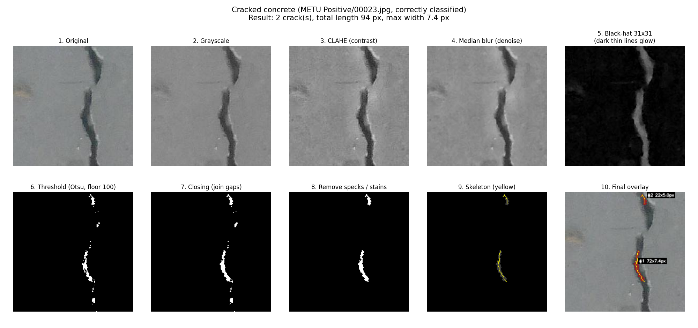

# Concrete Crack Detector

Detects cracks in photos of concrete and measures each crack's length and width, using
**classical image processing only** (OpenCV, NumPy, scikit-image, Matplotlib, pandas; no machine learning).

## Method (in simple words)
1. **Preprocess** - convert to gray, even out lighting (CLAHE), remove grain (median blur).
2. **Black-hat** - a morphological filter that makes thin *dark* lines (cracks) bright.
3. **Threshold** - Otsu's method, but never below a fixed contrast floor, so clean concrete gives "no crack".
4. **Cleanup** - closing joins broken pieces; specks and blob-like stains are removed by size and shape.
5. **Measure** - skeletonize each crack. *Length* = skeleton steps (diagonal step = sqrt 2).
   *Width* = 2 x distance-transform - 1 at each skeleton pixel (mean and max reported).
6. **Units** - pass `--mm-per-pixel`, or click a reference object of known size with `--calibrate`.



## Setup
```
pip install -r requirements.txt
```
Datasets: see [data/README.md](data/README.md).

## Usage
```
python main.py --image wall.jpg [--mm-per-pixel 0.2] [--kernel 15] [--floor 60] [--min-area 50]
python main.py --folder photos/                    # batch mode
python main.py --image wall.jpg --calibrate --ref-mm 100
python main.py --evaluate metu                     # evaluate on METU (2000 images, writes results/)
python main.py --tune                              # grid search kernel size and threshold floor
python -m pytest                                   # unit tests for measure.py
```
Single-image and batch runs save a step-by-step figure per image and `results/measurements.csv`
(`image, crack_id, length, mean_width, max_width, unit`).

## Results (METU, 2000 held-out images: 1001 cracked, 999 clean)
Kernel size and threshold floor were tuned on 400 *separate* validation images.
Every image's actual vs. predicted class is in [results/results.csv](results/results.csv) (wrong ones first).

| Method | Accuracy | Precision | Recall | F1 |
|---|---|---|---|---|
| **Proposed (black-hat)** | **95.5%** | **94.5%** | **96.5%** | **95.5%** |
| Canny edges | 92.8% | 91.2% | 94.8% | 93.0% |
| Global Otsu | 41.9% | 45.6% | 82.2% | 58.6% |

Confusion matrix (proposed): 966 true cracked, 943 true clean, 56 false alarms, 35 missed.
Pictures: `results/summary.png`, `results/wrong_predictions_p*.png`, `results/correct_examples.png`,
`results/pipeline_cracked.png`, `results/pipeline_clean.png`.

## Limitations
Image-level labels only (no pixel-level or physical-width validation); very wide cracks and rough textures
cause most errors; CrackForest evaluation is not implemented.

## Layout
`main.py` CLI | `config.py` all settings | `src/` preprocess, detect, measure, pipeline, evaluate | `tests/` | `paper/` write-up
